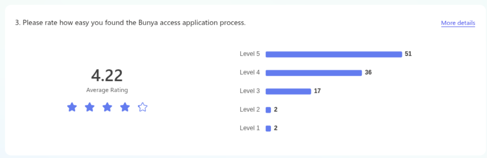
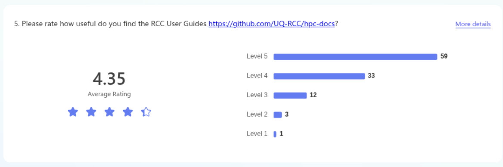
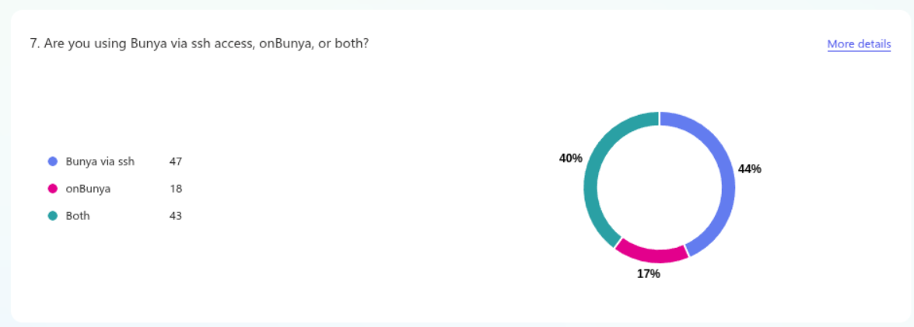
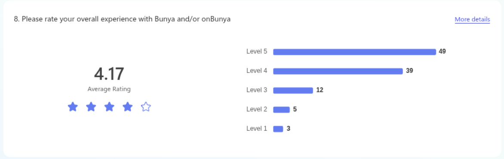
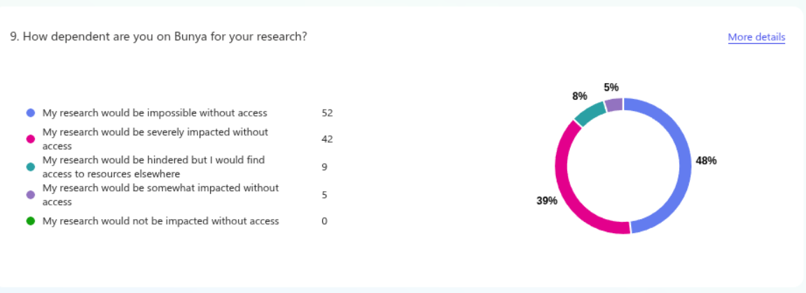
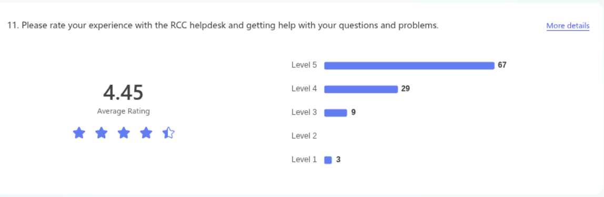
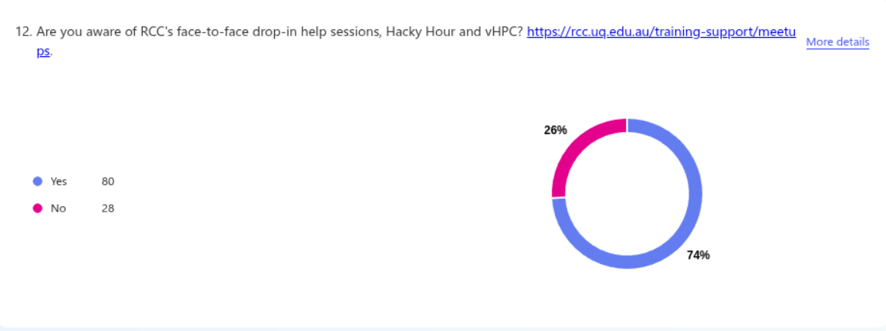
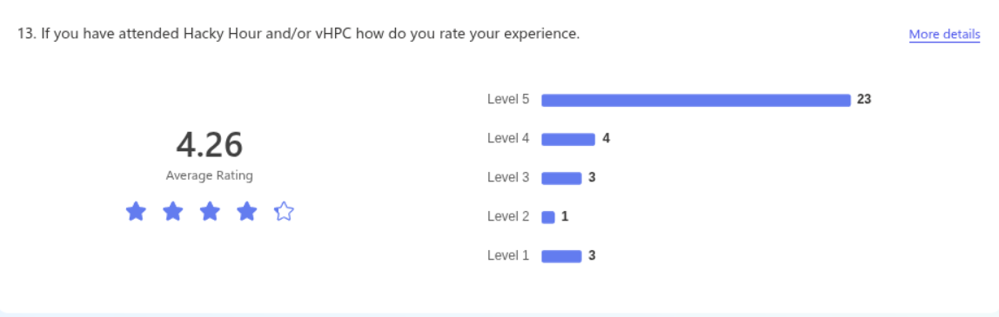

## Applying for access to Bunya 

In general, users were happy about the application process for Bunya access. The main concern from users was that new users are often not sure about the answers to some of the questions. In response to this, RCC has added clarification to the question text. 

Specific user concerns ranged from accounting groups, FoR codes, too many questions, not sure what and how much is required, not knowing what will be required/expected, long response times (up to 48 hours), and confusion about the need for RCC and QRIScloud. 

- Accounting groups from UQ have been merged into school, institute, centre, or research theme wide groups. Accounting groups from external institutions have been merged into a single group for each institution. This has made it easier for new users to know their accounting group and provides an existing accounting group for most users eliminating the time-consuming process to set up a new one. 
- There is currently no option to provide a drop-down or search list for FoR codes. RCC is working on making this available when a new management portal comes online which will incorporate the Bunya access application form in the future. 
- The application form asks as little as possible. The questions cover the contact details as well as information on what Bunya will be used for. The questions have evolved to alert RCC to unrealistic workloads or unsuitable use cases and have prevented problems on Bunya and for its users.  
- There is now a more detailed description of the application form and process at the start of the application to help users to know what information will be asked. Users are advised to check with their peers or supervisors if they do not know some of the information. 
- Applications to Bunya require human oversight. During times of high volume of applications, a 2 business-day turnaround is what is humanly possible.

## Graphical summaries of responses

Below are the graphical summaries for the survey's choice questions. In general users rated Bunya and user support above 4 stars. The suggestions and concerns from the free text questions have been summarised and responded to under the areas of:

- [Storage and Data Management](#storage-and-data-management)
- [Compute Resources and Performance](#compute-resources-and-performance)
- [System Reliability and Access](#system-reliability-and-access)
- [Authentication and Security (MFA)](#authentication-and-security-mfa)
- [Software and Environment Management](#software-and-environment-management)
- [Documentation, Training and Guidance](#documentation-training-and-guidance)
- [User Experience and Communication](#user-experience-and-communication)
- [Governance, Allocation and Transparency](#governance-allocation-and-transparency)
  

## Storage and Data Management 

Users have voiced a need for more flexible and/or larger storage option and a storage option that is between UQRDM and `/scratch`. The main concerns were 

- 90-day scratch deletion policy 
- `/home` and `/scratch` quotas are insufficient
- Problems recalling data from UQRDM storage allocations when the data is on archival media, only

### 90-day deletion policy

This does **not** mean everything in `/scratch` is deleted every 90 days. The 90-day limit is based on when a file was last accessed (written to, read from, opened, etc.). A file is deleted if it has not been accessed for the past 90 days. To put it simply, a file is deleted if it has not been used in any way for about 3 months. This means files within a scratch space will most likely all have different access dates and therefore will be deleted at different times. RCC asks users of the facilities to consider the following actions:

- Keep copies of important data in UQRDM
- Backup regularly to UQRDM
- Request data sets to be installed in `/scratch/opendata` or `/scratch/licenseddata`
- Keep .yml files of your software environments to reinstall from or keep copies of your software in UQRDM
- Request software to be installed as modules, .yml files are now accepted to install complex user software environments as modules
- Groups with quickly changing software environments can request a dedicated space in `/sw` to keep their software.
- Adapt your workflows to read large data directly from UQRDM, see the [Bunya Data Guide](https://docs.hpc.rcc.uq.edu.au/guides/data/bunya-userdata-guide/#qrisdata).

### Quotas for /home and /scratch

- The quotas of 50GB and 1 million files in `/home` will not be changed. This quota is very generous, compared to for example the 10GB given on Gadi (NCI), one of Australia’s two national supercomputers.
- Users should request that software environments be installed as modules where possible. .yml files for complex software environments are accepted for module installation.
- The quota of `/scratch/user` is very flexible and can be changed to support the needs of the individual user; see [the `/scratch/user/<username>` section of the Bunya Data Guide](https://docs.hpc.rcc.uq.edu.au/guides/data/bunya-userdata-guide/#scratchuserusername). `/scratch/user` uses burst quotas to allow users to go over quota for a limited time to support a wide range of workflows and their output. The base quota, burst quota, and number of files can all be changed.

### Clarifying data storage layers between HPC and RDM and how to optimise retrieval performance

- UQRDM Q storage record (presented as collections in `/QRISData`) uses a mixture of technology designed to expedite recall of data where possible. A significant amount of data that is stored in UQRDM Q storage records resides on both tape technology for safety and resiliency but also a spin down hard disk technology known as ZeroWatt. The typical latency of ZeroWatt is lower than that of tape. As a result, it can expedite recalls of data. A user is not in control of where data resides in the hierarchy and this is determined by storage policies inside UQ's data storage platforms based upon age and size.

- Optimising the performance of retrieval depends on the "shape" of the data put onto UQRDM Q storage records. Typically, transferring many small files into the UQRDM Q storage record, whilst possible, is costly in terms of performance of writes *and* reads. Bundling large data structures (hundreds or thousands of files) before transferring data to the RDM will provide a better user experience when a user recalls that data. The file comes back as one large stream of data which can then be unzipped, untarred, or expanded on scratch, rather than many tiny transfers and movements of offsets on the filesystem or archive media. This technique of bundling data before moving it to UQRDM Q storage records also results in less use of the UQRDM Q storage file quota.
 
## Compute Resources and Performance 

Users voiced a high demand for more GPU (especially H100) and CPU capacity. The main concerns were long queue times (>24 hours for GPUs) and difficulty getting interactive sessions. Users have requested:

- Short-queue partitions for interactive jobs 
- Increased job submission limit (currently 5000) 
- Higher per-user limits or shared group allocations
- Better visibility of queue status, fair share, and available GPUs
- Catching jobs that do not finish cleanly and block resources. 

### High priority QoS for short jobs

Providing a partition with a short queue, so that jobs start fast requires dedicated resources that are kept idle to be available for these jobs. This means full GPU/CPU nodes that are only available for short jobs and are therefore no longer available for any other jobs. Bunya uses QoS (quality of service) to set higher priorities for specific types of jobs across all resources, CPU and GPU. 

Bunya provides a dedicated partition and QoS for onBunya accelerated and standard desktops that require up to 24 hour runtime.
- The `gpu_viz` partition is exclusive for onBunya jobs and provides dedicated GPU resources such as the A16 and L40 GPUs. 
- The `viz` QoS is exclusive to onBunya jobs and has a priority of 30, three times that of the `gpu` and `normal` QoS. The `viz` QoS allows up to 24 hours of runtime, two jobs, two GPUs (one per job), and up to 500GB of CPU RAM per job. 

There are two high priority QoS for short jobs submitted via `sbatch`.
- `debug` QoS has a priority of 30, three times that of the `gpu` and `normal` QoS and allows 1 hour of runtime and up to two jobs.
- `short` QoS has a priority of 20, two times that of the `gpu` and `normal` QoS and allows 12 hours of runtime and up to two jobs.

### Job submission limits

Several user limits are in place to prevent a single user dominating Bunya and the resources. These user limits are set in the context of total available resources and what could be considered an acceptable use by a single user at any one time.

A limit of 5000 submitted jobs applies to the `normal` QoS and the `general` partition. The other QoSs have different and smaller submitted jobs limits. The submit limits are in place to stop the Slurm scheduler being overloaded. 

### Option for higher per-user limits or shared group allocations

Bunya operates on fair share and per-user limits. Fair share allows larger users to use resources, if available, beyond an equal fixed amount per user, but ensures that smaller users are able to get their jobs done as well. 

Bunya uses QoS (quality of service) to set per-user limits. There are available QoS that allow higher per-user limits, for example the `sdf` QoS that allows the use of up to 8 MI300x or MI355x GPUs. Access to these QoS is on application and is decided on a case-by-case basis. These QoS are still subject to fair share.

Providing shared group allocations is incompatible with fair share and would require an application process that is based on merit, set milestones, and reporting. RCC has made the operational choice that employing fair share and allocations at the same time on Bunya is not possible.

Users should consider some key differences between fair share and allocations.

- Fair share constantly refills and allows a user to keep running jobs even if their fair share is zero. A single user cannot affect the fair share of other users.
- Once an allocation is used, users can no longer run any jobs. And a single user can burn through a group's allocation, leaving the rest of the group with no allocation to run their jobs.

### Better visibility of queue status, fair share, and available GPUs

Individual users cannot see other users' jobs and usage on Bunya. RCC is investigating how compute node status and utilisation could be made available via a dashboard to users in the future.

### Catching jobs that do not finish cleanly and block resources

Jobs using a GPU node on Bunya that do not cleanly finish and block resources are automatically terminated by the system. See [how to check the utilisation](https://docs.hpc.rcc.uq.edu.au/guides/slurm/monitoringjobs/#how-to-know-what-resources-are-actually-being-utilised-by-a-job) for more information.

## System Reliability and Access 

Users have reported frequent disconnects, especially VS Code and some for onBunya. They have also reported that RStudio seems laggy. There were also complaints about too many outages but acknowledgement that this has improved. The main needs were

- More stable interactive environments
- Better performance and responsiveness

### More stable interactive environments

VS Code and other IDE applications are no longer permitted to run on Bunya's login nodes. This is due to problems they could cause to the load of the login node. Connections made to the login nodes with an IDE application are automatically terminated. Users can use the VSCode app provided via [onBunya](https://docs.hpc.rcc.uq.edu.au/guides/onbunya/ondemand-guide/) or start VSCode once they are on a compute node via an interactive job.

SSH and SFTP connections, via command line or clients like PuTTY, should set a keep-alive interval (`ServerAliveInterval` in OpenSSH; "Seconds between keepalives" in PuTTY). A setting of 300 (in seconds) is usually sufficient. This keeps the connection to the Bunya login node alive even when the user is not actively using the terminal from the connection. See [how to prevent timeouts](https://docs.hpc.rcc.uq.edu.au/guides/accessing-bunya/connecting-to-bunya/#preventing-ssh-session-timeouts) for more information.

### Better performance and responsiveness

The reports of RStudio being laggy could be due to not enough resources being made available in the desktop. These kinds of issues are best investigated while RCC staff can observe which is done best during one of RCC's face-to-face drop-in sessions, Hacky Hour or vHPC. 
 
## Authentication and Security (MFA) 

Users find the MFA prompt at every login as disruptive and they prefer other applications over Duo. Users have asked for

- Push-based authentication in addition to passcodes
- Support for YubiKeys or user-selected MFA methods 

During the August 2026 maintenance Bunya moved from Duo to Okta. Bunya's Okta setup currently only supports push-based authentication.

For the majority of users Bunya access is with active UQ credentials with existing MFA methods. Due to this Bunya will use UQ's MFA method for all UQ users. External users are currently directed to use other MFA methods that are accessible to them. 

Bunya's setup currently does not allow the use of YubiKeys or passcodes, but this may change in the future.

 
## Software and Environment Management 

The survey found that users are often missing software, or that the versions available are too old. Installing software themselves is often too hard. Others need to frequently build their own tools. The main challenges were with 

- Conda environments in limited `/home` space
- Container usage (Apptainer configuration, binds, etc.)
- Easy software request process (e.g., online form)
- No domain-specific tools and guidance
- No APIs (RDM, Slurm) and better integration with tools like VS Code 

### Conda environments in limited /home space

- `/home` is the best place to install software packages and software environments and it has a 1 million files quota to support this. Users should use existing software modules where possible. Bunya provides existing installations of Anaconda3, Miniconda3, and Miniforge for example. 
- Most Conda packages can be provided as a software module on Bunya and users are encouraged to submit a ticket to request installation.
- RCC offers to reproduce larger software environments for groups as a module from a provided .yml file.

### Container usage (Apptainer configuration, binds, etc.)

The Bunya user guide covers [container usage on Bunya](https://docs.hpc.rcc.uq.edu.au/guides/software/softwarecontainers/) which links to a more detailed guide on [using apptainer on Bunya](https://docs.hpc.rcc.uq.edu.au/guides/software/basics-apptainer/).

### Easy software request process (e.g., online form)
Software on Bunya can be requested by submitting a ticket which is done by emailing rcc-support@uq.edu.au. While a form to request software could be considered, it would ask for the same information as a ticket would:
- links to software
- license and access restrictions
- space requirements
- who is requesting and who is it for

### No domain-specific tools and guidance

RCC has expertise in high performance computing. While some in RCC have worked in research before, domain knowledge and support is expected to come from the user's research group and peers.

RCC offers a weekly face-to-face drop-in session, [Hacky Hour](https://docs.hpc.rcc.uq.edu.au/guides/getting-help/getting-help/#getting-hands-on-help), where there are volunteer domain experts from some areas available to answer questions. 

### No APIs (Slurm) and better integration with tools like VS Code

RCC is actively working on providing an API for Slurm soon.

Better integration with VS Code and other IDEs may be provided in the future.

## Documentation, Training and Guidance 

The responses and suggestions that users provided around the user guides and training were a major theme. Users highlighted significant gaps in usability, clarity, and structure of documentation and training. The main issues were

- The user guides are hard to navigate and cannot be searched
- The user guides are too technical and not beginner-friendly
- The user guides are lacking structure and progression: beginner to advanced
- Training includes too much on admin and governance and not enough hands on examples
- Training assumes too much Linux knowledge 

RCC has moved the RCC User Guides to a new home that provides a webpage front end. 

https://docs.hpc.rcc.uq.edu.au/

The new RCC User Guides feature a table of contents on the left listing all available guides. Each guide features a table of contents on the right to navigate within each guide.

The old main Bunya User Guide was separated into content specific sections and grouped under the relevant sections in the table of contents. 

The RCC User Guides now contain a [Quick Start Guide](https://docs.hpc.rcc.uq.edu.au/guides/getting-started/bunya-quick-start-guide/) and a section with short videos on [basic HPC and Linux commands](https://docs.hpc.rcc.uq.edu.au/guides/getting-started/general-hpc-videos/). The Unix command videos and the provided basic syntax overview can be used to prepare for the HPC Intro Training session.

Future work on Documentation, Training, and Guidance will involve
- Guides for specific software packages, where expertise is available
- The DVC RI portfolio is working on a Chatbot which will include RCC and Bunya
- The RCC Domain Champions Network meets every quarter. Champions are consulted around changes, new capabilities and purchases of new Bunya hardware. Champions raise problems from their domain and ensure that their domain is aware of important changes and new capabilities. RCC is working on making the Domain Champions public on the RCC webpages in the future.
- Restart RCC outreach seminars in institutes and schools

## User Experience and Communication 

Some users perceive support as slow, impersonal, and often unhelpful. They have requested

- Faster incident notifications and more proactive communication (even early warnings)
- More empathetic, tailored responses
- Fewer system changes (policies, modules, quotas) as they create confusion.
- Job start notifications
- Better onboarding and self-help resources

### Faster incident notifications and more proactive communication (even early warnings)
RCC keeps emailing users to a minimum. This ensures that notifications are taken seriously and are read by the majority of users. Where possible significant unforeseen service outages are posted on the [ITS Services page](https://status.its.uq.edu.au/) that users can check. Early warnings or notifications about minor outages or problems are usually posted in the message of the day (MOTD) on Bunya.

Mailouts to all Bunya users are governed by policy and unfortunately there is nothing quick about the process behind them. 

### More empathetic, tailored responses
- RCC uses a range of preset texts to provide consistent advice to users. RCC staff will tailor these if required to individual requests.
- The majority of questions and problems are difficult to solve over tickets so usually users are requested to come to one of RCC's face-to-face drop-in sessions [(Hacky Hour and vHPC)](https://docs.hpc.rcc.uq.edu.au/guides/getting-help/getting-help/#getting-hands-on-help) so RCC and volunteer staff can see what the user is doing and walk through with the user. Over many years, this has proven to be more effective and much quicker.
- Users who have had unhelpful or insensitive interactions with RCC staff have a [way to escalate](https://docs.hpc.rcc.uq.edu.au/guides/getting-help/getting-help/#escalating-concerns-or-complaints-which-will-be-treated-confidentially) if required.

### Fewer system changes (policies, modules, quotas) as they create confusion
- With yearly hardware phase injections into Bunya, configurations will inevitably have to change with the change in hardware, capacity, and capability. Bunya is not a static system like many other supercomputing facilities. This provides state-of-the-art hardware to researchers but also brings associated changes to support this hardware.
- New hardware and upgraded operating systems often require a change of software versions. Many users also request software upgrades and setup changes that may affect all of Bunya.
- Policies and Bunya setup often have to (rapidly) respond to changes in hardware, user profiles and behaviour, and cyber security threats. RCC will always provide as much warning as feasible and keep user impact to a minimum.
 
### Job start notifications

The RCC team is investigating feasible ways to provide email alerts to users when their jobs start. 

### Better onboarding and self-help resources
- RCC provides monthly HPC Introduction training which covers the basics such as logging in, transferring files, software modules, submitting jobs, and onBunya.
- The RCC User Guides include a [Quick Start Guide](https://docs.hpc.rcc.uq.edu.au/guides/getting-started/bunya-quick-start-guide/), with the main points and commands and links to further information
- The RCC User Guides include a range of [short videos](https://docs.hpc.rcc.uq.edu.au/guides/getting-started/general-hpc-videos/) that walk through some basic HPC concepts and basic Linux commands.
- RCC offers two 1-hour face-to-face drop-in sessions, [Hacky Hour and vHPC](https://docs.hpc.rcc.uq.edu.au/guides/getting-help/getting-help/#getting-hands-on-help), per week where staff can walk users through getting started on Bunya. 
 
## Governance, Allocation and Transparency 

Users felt that there was not enough information and clarity around how resources are allocated, accounting groups, and fair share. There is a need for 

- Transparency, or easily accessible information on scheduling
- Clear way to request more resources
- Better explanation of system/queue behaviour

The RCC User Guides now have easier to find information on Slurm. They provide a section on [Slurm Tips](https://docs.hpc.rcc.uq.edu.au/guides/slurm/slurm-tips/) which currently features advice on how to better target GPUs. RCC will expand this section with further tips on how to more effectively target Bunya resources. 
